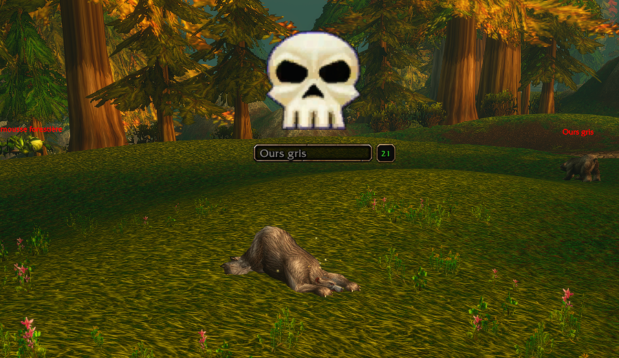
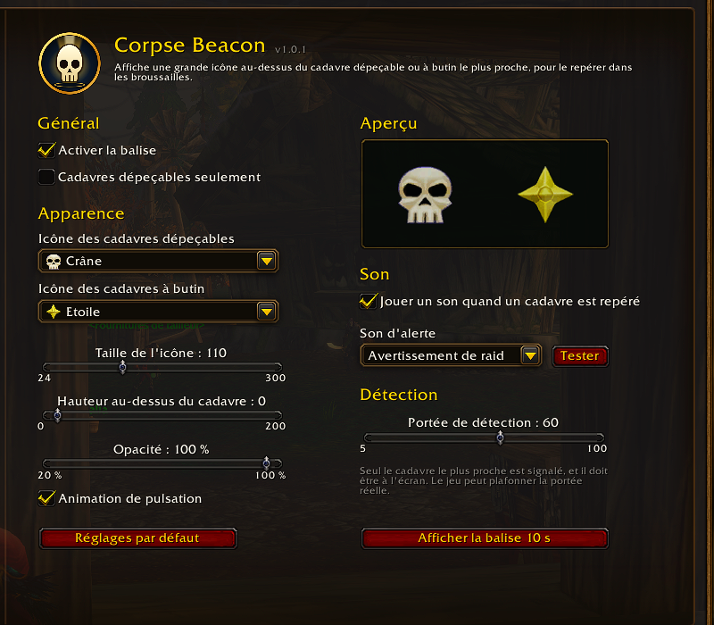

# Corpse Beacon

A World of Warcraft addon for skinners: it puts a large icon above the nearest corpse you can skin or loot, so you find it in the undergrowth instead of combing the bushes.

## What it does

- **One corpse, clearly marked** — the nearest corpse the game lets you interact with gets an icon above it: a skull when it is skinnable, a star when it only holds loot.
- **Already looted, still skinnable** — a corpse emptied of its loot keeps its beacon for as long as the game still offers it for skinning
- **A sound when a corpse is found**, chosen from 18 game sounds.
- **It clears itself** — when the game stops offering the corpse, the icon goes away on its own

## Options

`/cb` (or Options → AddOns → Corpse Beacon)

Icons, size, height above the corpse, opacity, pulsing animation, alert sound, detection range, a "skinnable corpses only" filter, a live preview and a button that shows the beacon for 10 seconds.

## What it cannot do

- It marks **one** corpse at a time: the nearest one.
- The corpse has to be **on screen**.
- The range slider goes up to 100 yards, but the game decides the real limit; expect a few dozen yards.
- It does not draw an arrow or a map pin: the game gives addons no position for a corpse.

## Settings it changes

The beacon relies on the game's own interact targeting. When enabled, the addon sets four game settings (`SoftTargetInteract`, `SoftTargetInteractArc`, `SoftTargetNameplateInteract`, `SoftTargetInteractRange`). Your previous values are saved on first use and restored when you disable the beacon (`/cb off`).

## Languages

English, Français, Deutsch, Español, Italiano, Português, Русский, 한국어, 简体中文, 繁體中文. Only the French text has been reviewed in game; corrections are welcome.

## Supported client

World of Warcraft Forever (interface 16001).

## Development

| Path | What |
|---|---|
| `CorpseBeacon.lua` | the beacon: finds the corpse, shows the icon, plays the sound |
| `Options.lua` | the options page |
| `Locales.lua` | every translation |
| `media/` | the logo (`logo.svg` is the source of `logo.tga`) |
| `tests/ingame.sh` | in-game test suite, driven through a local bridge: every option is operated through its real control and its effect is measured on the beacon |
| `tests/check_locales.py` | offline: all languages have the same keys |
| `docs/CURSEFORGE.md` | source of the CurseForge project page |
| `CHANGES.md` | release notes; the Release workflow publishes the section of the tagged version |

A release is a tag: `git tag v1.0.0 && git push --tags`.

## License

MIT
