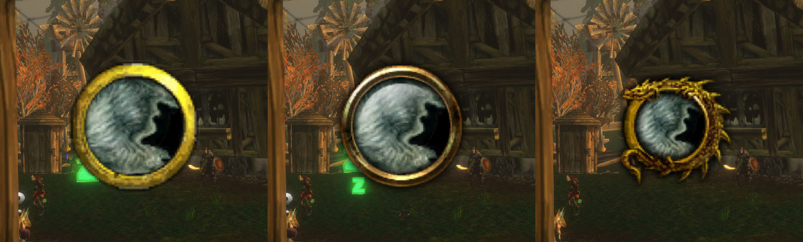
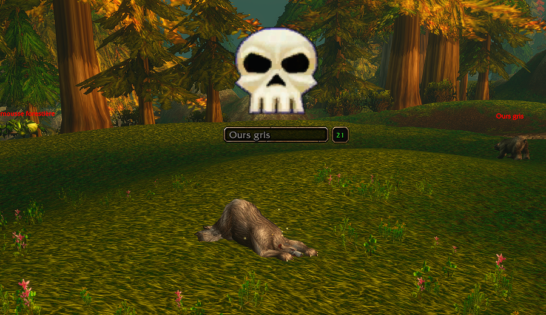
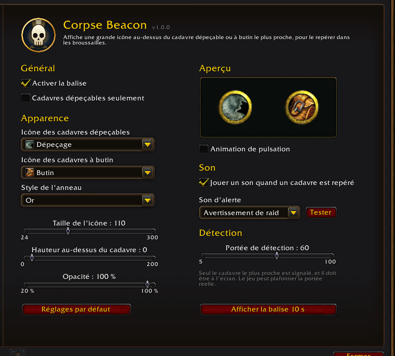

<!--
CurseForge project page for Corpse Beacon.
The upload API cannot edit descriptions: paste everything below this comment
into authors.curseforge.com → Corpse Beacon → Description, in Markdown mode.

Summary line (General tab):
  A large icon above the nearest skinnable or lootable corpse, so skinners find it in the undergrowth.

Images live in the repo (docs/assets): update them there and the page follows.
-->

## The corpse is somewhere in those bushes

You are a skinner. There is a dead tiger somewhere in the undergrowth. You know it is there. You cannot see it.

**Corpse Beacon puts a large icon above the nearest corpse you can skin or loot.**

---

## What it does

- **The Skinning icon above skinnable corpses, a bag above corpses that only hold loot** — round, inside a ring taken from the game's own art
- **Three ring styles** — gold, bronze or dragon; or pick the logo or any raid icon instead
- **Already looted, still skinnable** — a corpse emptied of its loot keeps its beacon for as long as the game still offers it for skinning
- **A sound when a corpse is found**, picked from 18 game sounds
- **It clears itself** — when the game stops offering the corpse, the icon goes away on its own

*Above a real corpse, here with the skull raid icon.*

---

## Options

Type `/cb`, or open Options → AddOns → Corpse Beacon.

- Icon for skinnable corpses, icon for corpses with loot
- Ring style: gold, bronze or dragon
- Size, height above the corpse, opacity, pulsing animation
- Alert sound, with a test button
- Detection range
- "Skinnable corpses only"
- Live preview, and a button that shows the beacon for 10 seconds

---

## What it cannot do

- It marks **one** corpse at a time: the nearest one
- The corpse has to be **on screen**
- The range slider goes up to 100 yards, but the game decides the real limit; expect a few dozen yards
- No arrow, no map pin: the game gives addons no position for a corpse
- Behaviour **while you are in combat** has not been verified yet: the icon may only appear once the fight is over

---

## Settings it changes

The beacon relies on the game's own interact targeting. When enabled, the addon sets four game settings (`SoftTargetInteract`, `SoftTargetInteractArc`, `SoftTargetNameplateInteract`, `SoftTargetInteractRange`). Your previous values are saved on first use and restored when you disable the beacon (`/cb off`).

---

## Languages

English, Français, Deutsch, Español, Italiano, Português, Русский, 한국어, 简体中文, 繁體中文.
Only the French text has been reviewed in game. Found a mistake? Open an issue on [GitHub](https://github.com/kriffin/CorpseBeacon/issues).

---

## Supported client

World of Warcraft Forever.
